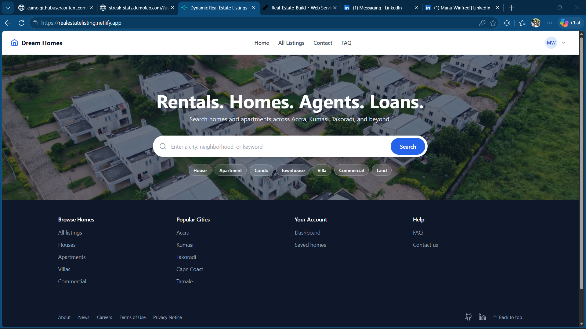
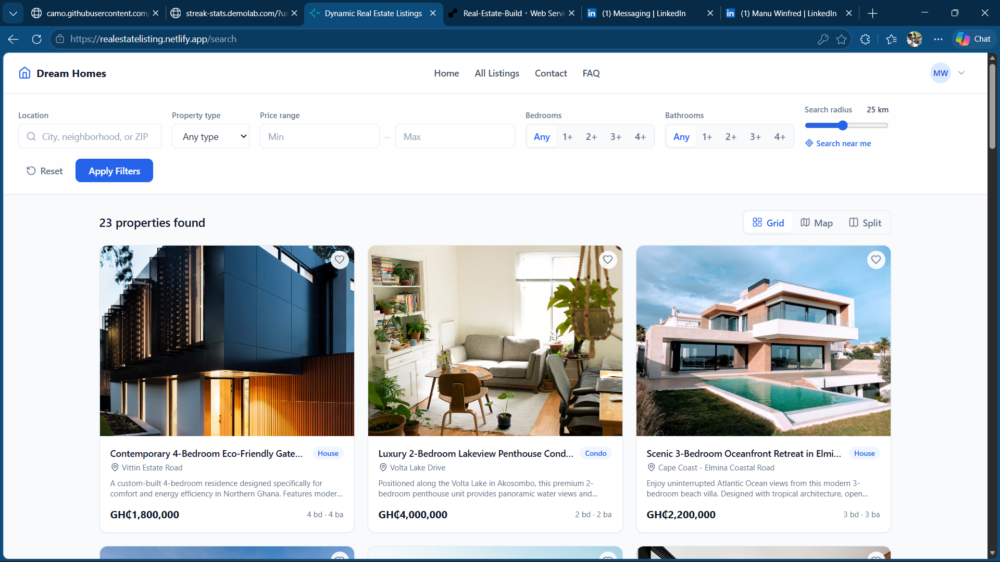
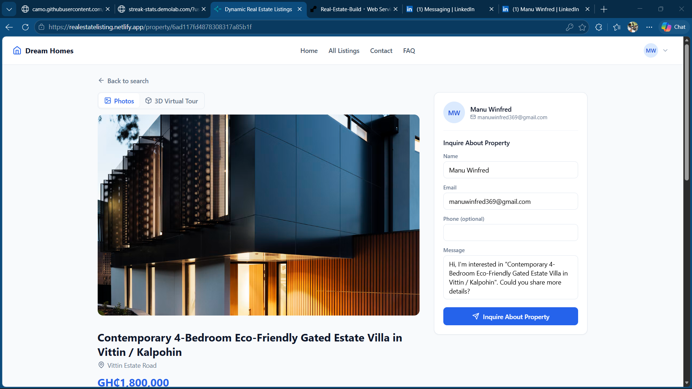
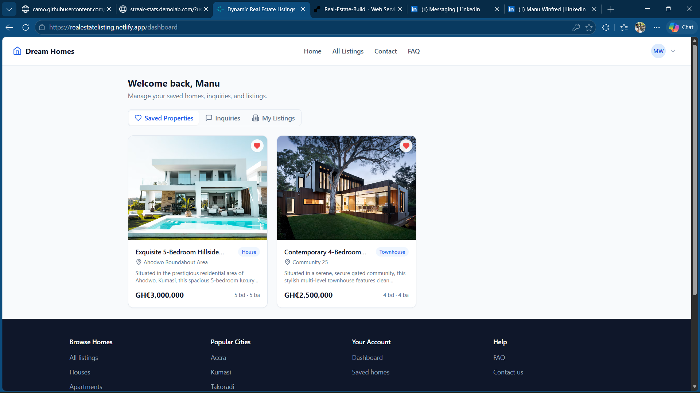

<div align="center">

# Dream Homes

**A modern real estate marketplace for finding, saving, and listing properties across Ghana and beyond.**


<br />

**[Live Demo](https://realestatelisting.netlify.app/)** · **[API](https://real-estate-build-s4tc.onrender.com/api/properties)**

[App Preview](#app-preview) · [Features](#features) · [Tech Stack](#tech-stack) · [Getting Started](#project-setup--installation) · [API](#api-endpoints) · [Roadmap](#future-enhancements) · [Author](#author)

</div>

<!--
  Build status badge:
  [](https://github.com/badjuvi6/Real-Estate-Build/actions)
-->

---

## App Preview

<div align="center">
  
  <br/><br/>
  
  <br/><br/>
  
  <br/><br/>
  
</div>

---

## About

Dream Homes is a full-stack **MERN** application (MongoDB, Express, React, Node.js) for browsing and publishing real estate listings. Visitors can search by city, neighborhood, type, price, and distance, explore results on an interactive map, take a 3D tour of a property, and save favorites. Agents can publish new listings, including map coordinates, from a personal dashboard.

The sample data focuses on Ghana (Accra, Tema, Kumasi, Takoradi, Cape Coast, and Tamale), with prices in both GHS and USD, but nothing in the code is Ghana-specific.

> All listings, agents, and photos in the seed data are fictional and exist for demonstration only.

---

## Features

### Frontend

- **Landing page** with a full-width hero, a city / neighborhood / keyword search bar, and one-click property-type shortcuts.
- **Live search and filters.** Location text, property type, price range, minimum bedrooms and bathrooms, and a distance radius. Changes are debounced into a single server-side query. "Search near me" uses the browser's Geolocation API.
- **Three ways to browse.** Grid, map, or a split view with a scrollable list beside a pinned map. On mobile the filters move into a slide-over drawer and the split view stacks vertically.
- **Interactive maps.** Leaflet with OpenStreetMap tiles and a Standard / Satellite layer switch. Marker popups show a photo, price, and link. Markers narrow to the visible viewport, and hovering or clicking a card or pin highlights its counterpart.
- **Property detail pages.** Photo gallery with thumbnails, key stats, overview, amenities, year built, an embedded location map, and a sticky agent sidebar with an inquiry form.
- **3D virtual tour.** An interactive 3D floor plan built with Three.js and React Three Fiber, with orbit, pan, and zoom controls, clickable room hotspots, and a fullscreen mode. It is generated from each property's bedroom and bathroom counts and is code-split, so it only downloads when opened.
- **Accounts and favorites.** Login and register modals, a heart toggle on every listing card, and protected routes.
- **User dashboard.** Saved properties, inquiries you have sent, and, for agents, a form to publish new listings with coordinates, cover image, and panorama links.
- **Polish.** GHS / USD currency formatting, automatic fallback for broken images, loading skeletons, empty states with a reset action, FAQ and Contact pages, and a responsive layout down to small phones.

### Backend

- **REST API** built on Express with modular routers, controllers, and middleware.
- **Geospatial search.** Locations are stored as GeoJSON points with a `2dsphere` index and queried with `$geoWithin`.
- **Combinable filters.** Free-text search, city, property type, price range, minimum bedrooms and bathrooms, and a geo radius can all be used together in one request. Invalid parameters return a clear `400`.
- **Authentication and authorization.** JWT sessions, bcrypt-hashed passwords, and role-based access (`user` and `agent`). Only agents can create, update, or delete listings.
- **Security basics.** Passwords are never returned in any response, login errors are generic to prevent email enumeration, and route parameters are validated.
- **Image handling.** Direct uploads to Cloudinary (images only, 5 MB limit) or plain image URLs.
- **Seed script** that loads 15 Ghanaian listings and two demo accounts in one command.

### Listing data model

| Field | Details |
| --- | --- |
| `title`, `description` | Required text |
| `propertyType` | `House`, `Apartment`, `Condo`, `Townhouse`, `Villa`, `Commercial`, `Land` |
| `price`, `currency` | Number plus `GHS` or `USD` |
| `bedrooms`, `bathrooms` | Numbers |
| `areaSqFt`, `yearBuilt` | Numbers |
| `address`, `city`, `region` | Text |
| `location` | GeoJSON `Point`, stored as `[longitude, latitude]` |
| `imageUrl`, `images[]` | Cover photo and gallery |
| `panoramaUrl` | Link to an equirectangular 360° image (stored for a future viewer) |
| `amenities[]` | List of strings |
| `agent` | Contact details, taken from the logged-in agent's account |

---

## Tech Stack

| Layer | Technology | Role |
| --- | --- | --- |
| **Frontend** | React 18 | UI library |
| | Vite 5 | Dev server and production bundler |
| | React Router 6 | Client-side routing |
| | Tailwind CSS 3 | Utility-first styling |
| | Leaflet and React-Leaflet | Interactive maps |
| | Three.js, React Three Fiber, Drei | 3D virtual tour |
| | Lucide React | Icons |
| | JavaScript (ES2020+ modules) | Language |
| **Backend** | Node.js 18+ | Runtime |
| | Express 4 | REST API framework |
| | Mongoose 8 | MongoDB object modeling |
| | jsonwebtoken and bcryptjs | Authentication and password hashing |
| | Multer and Cloudinary | Image upload handling |
| | CORS and dotenv | Cross-origin access and configuration |
| **Database** | MongoDB Atlas | Managed document database with geospatial indexing |
| **Deployment** | Netlify | Frontend hosting |
| | Render | Backend hosting |

---

## Project Structure

```text
dream-homes/
├── real-estate-backend/          # Express REST API
│   ├── controllers/              # Request handlers (auth, favorites)
│   ├── middleware/               # JWT verification and role guards
│   ├── models/                   # Mongoose schemas: Property, User, Inquiry
│   ├── routes/                   # properties, auth, users, inquiries
│   ├── seed.js                   # Sample Ghana listings and demo accounts
│   └── server.js                 # Application entry point
└── real-estate-frontend/         # React + Vite single-page app
    └── src/
        ├── api/                  # Fetch helpers for each API area
        ├── components/           # Navbar, Footer, filters, map, 3D tour, cards, modals
        ├── context/              # AuthContext (JWT session and favorites)
        ├── hooks/                # useDebouncedCallback
        ├── pages/                # Home, Search, PropertyDetail, Dashboard, FAQ, Contact
        └── utils/                # Price and image helpers

```

---

## Project Setup & Installation

### Prerequisites

* [Node.js](https://nodejs.org/) 18 or newer, and npm
* A MongoDB database, either a free [MongoDB Atlas](https://www.mongodb.com/atlas) cluster or a local instance
* *(Optional)* A [Cloudinary](https://cloudinary.com/) account, only needed for direct image-file uploads. Listings that use image links work without it.

### 1. Clone the repository

```bash
git clone [https://github.com/badjuvi6/Real-Estate-Build.git](https://github.com/badjuvi6/Real-Estate-Build.git)
cd Real-Estate-Build

```

### 2. Start the backend (`real-estate-backend`)

```bash
cd real-estate-backend
npm install
cp .env.example .env      # then fill in the values (see Environment Variables)
npm run seed              # optional: load sample listings and demo accounts
npm run dev               # API at http://localhost:3000 (auto-restarts with nodemon)

```

> [!WARNING]
> `npm run seed` **deletes every document in the `properties` and `users` collections** before inserting the sample data. Only run it against a database you are happy to reset.

### 3. Start the frontend (`real-estate-frontend`)

Open a second terminal:

```bash
cd real-estate-frontend
npm install
echo "VITE_API_BASE_URL=[https://real-estate-build-s4tc.onrender.com](https://real-estate-build-s4tc.onrender.com)" > .env
npm run dev               # App at http://localhost:5173

```

Open **http://localhost:5173** and you should see the landing page with sample listings.

### Demo accounts

Created by the seed script, for local development only:

| Role | Email | Password |
| --- | --- | --- |
| Buyer | `buyer@example.com` | `password123` |
| Agent | `agent@example.com` | `password123` |

Log in as the agent to see the **My Listings** tab on the dashboard.

### Available scripts

| Package | Command | Description |
| --- | --- | --- |
| Backend | `npm run dev` | Start the API with nodemon (auto-reload) |
|  | `npm start` | Start the API with Node (used in production) |
|  | `npm run seed` | Reset and seed the database |
| Frontend | `npm run dev` | Start the Vite dev server |
|  | `npm run build` | Create a production build in `dist/` |
|  | `npm run preview` | Serve the production build locally |

---

## Environment Variables

### Backend: `real-estate-backend/.env`

```env
# Server
PORT=3000

# Database (MongoDB Atlas or local)
MONGODB_URI=mongodb+srv://<user>:<password>@<cluster>.mongodb.net/realestate_db?retryWrites=true&w=majority

# Authentication - generate one with:
#   node -e "console.log(require('crypto').randomBytes(48).toString('hex'))"
JWT_SECRET=your-long-random-secret

# Cloudinary (only needed for direct image-file uploads)
CLOUDINARY_CLOUD_NAME=your-cloud-name
CLOUDINARY_API_KEY=your-api-key
CLOUDINARY_API_SECRET=your-api-secret

```

| Variable | Required | Description |
| --- | --- | --- |
| `MONGODB_URI` | Yes | MongoDB connection string. The server exits if it cannot connect. |
| `JWT_SECRET` | Yes | Secret used to sign and verify login tokens. The server refuses to start without it. |
| `PORT` | No | Port for the API. Defaults to `3000`. |
| `CLOUDINARY_CLOUD_NAME`, `CLOUDINARY_API_KEY`, `CLOUDINARY_API_SECRET` | No | Only needed to upload image files. Without them the API still runs, and listings can use image URLs instead. |

### Frontend: `real-estate-frontend/.env`

```env
VITE_API_BASE_URL=[https://real-estate-build-s4tc.onrender.com](https://real-estate-build-s4tc.onrender.com)

```

| Variable | Required | Description |
| --- | --- | --- |
| `VITE_API_BASE_URL` | No | Base URL of the backend API. Defaults to `http://localhost:3000`. |

> [!IMPORTANT]
> Never commit a real `.env` file. Vite embeds every `VITE_*` variable into the public JavaScript bundle, so only put non-secret values in the frontend `.env`.

---

## API Endpoints

Base URL: `https://real-estate-build-s4tc.onrender.com` locally, or your Render URL in production. All bodies are JSON unless noted.

### Properties

| Method | Endpoint | Description | Access |
| --- | --- | --- | --- |
| `GET` | `/api/properties` | List properties, with optional filters (see below), newest first | Public |
| `GET` | `/api/properties/radius` | Properties within a radius of a point (`lat`, `lng`, and `radius` in km are all required) | Public |
| `GET` | `/api/properties/:id` | Get one property. Returns `400` for a malformed ID and `404` if not found | Public |
| `POST` | `/api/properties` | Create a listing (`multipart/form-data`, with an optional `image` file) | Agent |
| `PUT` | `/api/properties/:id` | Update a listing | Agent |
| `DELETE` | `/api/properties/:id` | Delete a listing | Agent |

**Query parameters for `GET /api/properties**` (all optional and combinable):

| Parameter | Example | Behavior |
| --- | --- | --- |
| `search` | `search=east legon` | Case-insensitive partial match on title, description, address, and city |
| `city` | `city=Accra` | Exact (case-insensitive) match on city |
| `propertyType` | `propertyType=Villa` | Must be one of the supported property types |
| `minPrice`, `maxPrice` | `minPrice=300000` | Inclusive bounds. These compare the raw number and do not convert between GHS and USD |
| `bedrooms`, `bathrooms` | `bedrooms=3` | Treated as a minimum, so `3` means "3 or more" |
| `lat`, `lng`, `radius` | `lat=5.6&lng=-0.18&radius=15` | Geo filter with the radius in km. All three must be provided together |

### Authentication

| Method | Endpoint | Description | Access |
| --- | --- | --- | --- |
| `POST` | `/api/auth/register` | Create an account (`name`, `email`, `password` of at least 8 characters, optional `role`) and receive a JWT | Public |
| `POST` | `/api/auth/login` | Log in and receive a JWT | Public |
| `GET` | `/api/auth/me` | Get the current user | Bearer token |

### Favorites

| Method | Endpoint | Description | Access |
| --- | --- | --- | --- |
| `GET` | `/api/users/favorites` | List the current user's saved properties | Bearer token |
| `POST` | `/api/users/favorites/:propertyId` | Toggle a property in or out of favorites | Bearer token |

### Inquiries

| Method | Endpoint | Description | Access |
| --- | --- | --- | --- |
| `POST` | `/api/inquiries` | Send a message about a property. It is linked to your account if you are logged in | Public (token optional) |
| `GET` | `/api/inquiries/mine` | List inquiries you have sent | Bearer token |

Authenticated requests send the token in a header: `Authorization: Bearer <token>`.

---

## Deployment

The app is deployed as two independent services plus a managed database.

**Backend on Render** (Web Service)

* Root directory: `real-estate-backend`
* Build command: `npm install`
* Start command: `npm start`
* Environment variables: `MONGODB_URI`, `JWT_SECRET`, and the optional Cloudinary variables
* In MongoDB Atlas, allow Render to connect under **Network Access**.
* If you use Render's free tier, the first request after a period of inactivity can take a while while the service wakes up.

**Frontend on Netlify**

* Base directory: `real-estate-frontend`
* Build command: `npm run build`
* Publish directory: `real-estate-frontend/dist`
* Environment variable: `VITE_API_BASE_URL` set to your Render URL. It is read at build time, so redeploy after changing it.
* Because the app uses client-side routing, add a file at `real-estate-frontend/public/_redirects` containing:
```text
/* /index.html 200

```


> [!NOTE]
> CORS is currently open to all origins. For production, restrict it to your Netlify domain in `server.js`.

---

## Future Enhancements

* [ ] **360° panoramic tours.** Render each listing's stored `panoramaUrl` in a photo-sphere viewer. Today's 3D tour is a generated floor plan, and the panorama field is already in the data model.
* [ ] **Listing management UI.** A "My Listings" view in the dashboard with edit and delete. The API already supports both.
* [ ] **Listing ownership.** Add a `createdBy` field and ownership checks so agents can only modify their own listings.
* [ ] **Agent verification.** Replace self-selected roles with a license check, verified email domain, or admin approval.
* [ ] **Contact form backend.** Persist messages from the Contact page and send email notifications to agents.
* [ ] **Place search.** Geocode a typed place name (such as "Kumasi") to use as the center of a radius search, instead of relying on browser geolocation.
* [ ] **Production map tiles.** Move from the public OpenStreetMap tile server to a dedicated provider such as Mapbox or MapTiler, with vector tiles and clustering for large result sets.
* [ ] **Sale / rent listing types** and a mortgage calculator.
* [ ] **Pagination and sorting** for large result sets, with a MongoDB text index or Atlas Search for faster text queries.
* [ ] **Hardened sessions.** httpOnly-cookie auth with refresh tokens in place of tokens stored in `localStorage`.
* [ ] **Automated tests and CI.** Unit and integration tests with a GitHub Actions workflow.

---

## Credits & Attribution

* Map data © [OpenStreetMap](https://www.openstreetmap.org/copyright) contributors. Satellite imagery © Esri, World Imagery.
* Sample photos come from [Unsplash](https://unsplash.com/) and [Pexels](https://www.pexels.com/). Demo 360° panoramas are from the open-source [Pannellum](https://pannellum.org/) project.
* Icons by [Lucide](https://lucide.dev/).

---

## License

Distributed under the MIT License. See `LICENSE` for details.

---

## Author

**Manu Winfred**

* GitHub: [@badjuvi6](https://github.com/badjuvi6)
* LinkedIn: [Manu Winfred](https://www.linkedin.com/in/manu-winfred-bb801b434/)

If you find this project useful or interesting, consider giving it a star.
